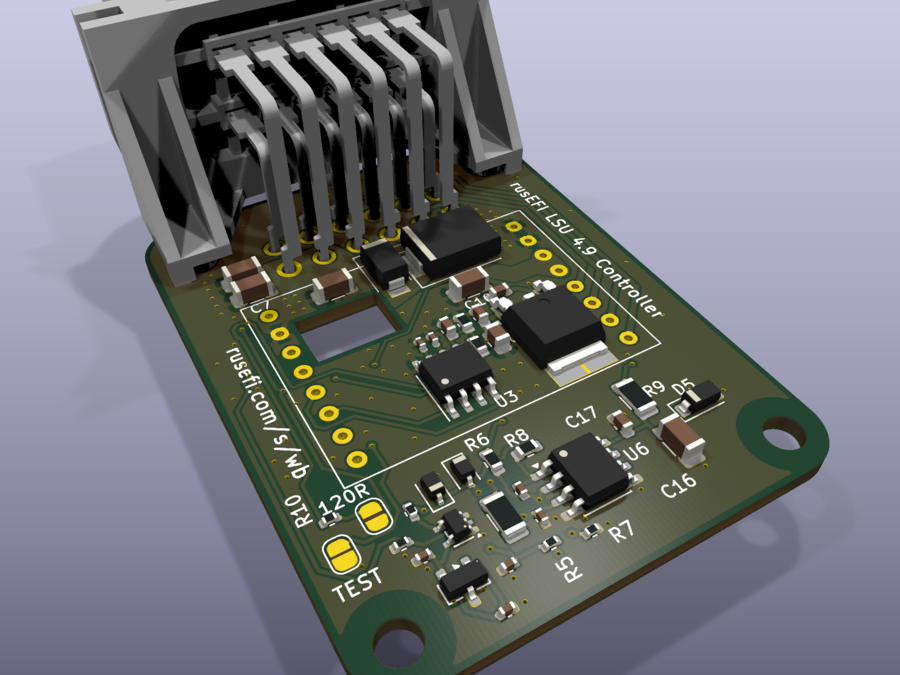
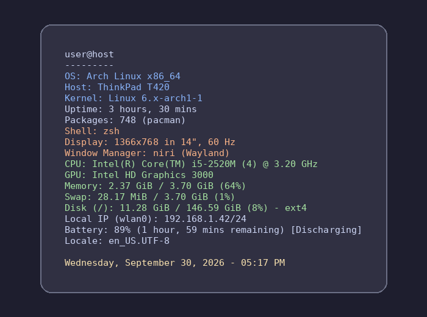

<h1 align="center">toolbox</h1>

<p align="center">
  <strong>Claude Code skills, Linux fixes and small tools, from one person's bench.</strong><br>
  PCB design, F-Droid releases and upstream PRs with an AI doing the legwork,<br>
  plus the scripts and configs that keep an old ThinkPad running.
</p>

<p align="center">
  
  
  
  
</p>

<p align="center">
  <a href="#skills"><b>Skills</b></a> •
  <a href="#linux"><b>Linux</b></a> •
  <a href="#study"><b>Study</b></a> •
  <a href="#utils"><b>Utils</b></a> •
  <a href="#dotfiles"><b>Dotfiles</b></a> •
  <a href="#writing"><b>Writing</b></a>
</p>

---

## Skills

[Claude Code](https://claude.com/claude-code) skills: folders of instructions and scripts that Claude loads when a
task calls for them. Each one is self-contained, with a README for people.

| Skill | What it does | Used on |
|---|---|---|
| [**pcb-design**](skills/pcb-design/) | Design, place, autoroute, audit and order a custom PCB with KiCad, Freerouting and JLCPCB assembly. Sets the project up with a stage-gated state file, check scripts, a release gate that refuses unready fab files, and an audit pack for a second model. | [wideband-work](https://github.com/flyboy-byte/wideband-work): routed, checked, fab files exported; not ordered yet |
| [**fdroid**](skills/fdroid/) | Get an Android app into F-Droid and keep it updated: metadata, the merge request, reproducible builds signed with your own key, ABI splits, reading CI and build-server logs. Deepest on Expo / React Native. | [drag-tree](https://f-droid.org/packages/com.flyboybyte.dragtree/): on F-Droid, reproducible |
| [**oss-contribute**](https://github.com/flyboy-byte/oss/tree/main/skill/oss-contribute) | Contribute to any open-source project the careful way, from a docs fix or bug report to a tested fix: checks the AI policy, avoids duplicate PRs, reproduces before fixing, proves tests fail without the fix, runs what CI runs, writes honest PRs, comments on others' PRs only with evidence. Lives in its own repo, [oss](https://github.com/flyboy-byte/oss). | 16 merged upstream PRs: [solidcore](https://github.com/tangency-labs/solidcore/pulls?q=is%3Apr+is%3Amerged+author%3Aflyboy-byte) (11), [solidcraft](https://github.com/tangency-labs/solidcraft/pulls?q=is%3Apr+is%3Amerged+author%3Aflyboy-byte) (4), [cadcraft](https://github.com/storytold/cadcraft/pulls?q=is%3Apr+is%3Amerged+author%3Aflyboy-byte) (1) |
| [**plan-scaffolding**](skills/plan-scaffolding/) | Turns a spark, a half-built project or a loose plan doc into a phase-gated tracker plus a small doc set. Phases only advance on something real (a test, a run, a decision), not on more docs. Unverified claims go to a deep-research queue instead of being guessed. | [disc-tracker](https://github.com/flyboy-byte/disc-tracker/tree/main/app/plan): Android port, scaffolded mid-build |
| [**readme**](skills/readme/) | Writes or overhauls a README so a skimmer gets it in 30 seconds, then checks the page as GitHub actually renders it in a browser: dropped alerts, broken images, code that scrolls off a phone. | This repo's README |
| [**ase-study**](https://github.com/flyboy-byte/asep-study/tree/main/workflow/skills/ase-study) | Builds automotive (ASE / ASEP) study material from your notes and public course material: finding sources, checking coverage, practice questions, exam guides. Lives in its own repo. | [asep-study](https://github.com/flyboy-byte/asep-study) |
| [**pkgfilter**](skills/pkgfilter/) | Finds what's eating your disk and which Arch packages are bloat, explains how safe each big folder is to clear, and leaves the deleting to you. Remembers what you said to keep. | My own Arch laptop |

<table>
  <tr>
    <td width="50%" valign="top">
      
      <br><sub><b>pcb-design:</b> the wideband carrier board, a 3D render from KiCad. Schematic and layout were generated from code.</sub>
    </td>
    <td width="50%" valign="top">
      
      <br><sub><b>linux/wallpaper:</b> live system-info wallpaper, a real frame from my laptop on niri.</sub>
    </td>
  </tr>
</table>

### Install a skill

```bash
git clone https://github.com/flyboy-byte/toolbox.git
cp -r toolbox/skills/<name> ~/.claude/skills/
```

Then ask Claude for the thing the skill does ("design a PCB", "get this app on F-Droid"); it picks the skill up from
its description. How a skill folder is laid out and how to add one: [`skills/README.md`](skills/README.md).

> [!NOTE]
> pcb-design is based on sidewinderzz's skill from a working board and keeps that MIT license
> ([`skills/pcb-design/LICENSE`](skills/pcb-design/LICENSE)).

---

## Linux

Fixes and desktop tools. Details in [`linux/README.md`](linux/README.md).

| | What it does |
|---|---|
| [**vfs0090-rhel**](linux/vfs0090-rhel/) | Validity `138a:0090` fingerprint sensor with `fprintd` on RHEL 10 / CentOS Stream 10, without touching the system `libfprint`. LGPL-2.1-or-later. |
| [**field-mode**](linux/field-mode/) | One command for off-AC use on LXQt: CPU governor, WiFi, brightness and TLP profile, and back. |
| [**wallpaper**](linux/wallpaper/) | Live system-info wallpaper that redraws when your stats change, for niri or KDE Plasma. |
| [`mouse-jiggler.py`](linux/mouse-jiggler.py) | Keeps the screen awake on KDE, X11 or Wayland. |
| [`pkgfilter.py`](linux/pkgfilter.py) | The original interactive Arch bloat hunter that the skill grew out of. |

## Study

Visualizers and calculators from automotive and ham radio classes. Details in [`study/README.md`](study/README.md).

| | What it does |
|---|---|
| [`pwm_signal_gui.py`](study/pwm_signal_gui.py) | Live PWM square wave with adjustable frequency and duty cycle (tkinter). |
| [`python_phasor_pm.py`](study/python_phasor_pm.py) | Phase-modulation phasor and waveform with live sliders (matplotlib). |
| [`fuel_injection_calc.py`](study/fuel_injection_calc.py) | Fuel mass and volume per stroke for 4-stroke engines. |

## Utils

One-file utilities. Details in [`utils/README.md`](utils/README.md).

| | What it does |
|---|---|
| [`pcapdroid_analyze.py`](utils/pcapdroid_analyze.py) | Sorts a PCAPdroid export into normal, elevated and concerning traffic, per app. |
| [`strip_passwords.py`](utils/strip_passwords.py) | Google Passwords export → list of domains, credentials dropped. |
| [`chat_compress.py`](utils/chat_compress.py) | Shrinks an AI chat markdown export for re-upload. |
| [`teleprompter.py`](utils/teleprompter.py) | Scrolling teleprompter for video scripts (tkinter). |
| [`whitepaper-formatter.html`](utils/whitepaper-formatter.html) | Raw research text → structured white paper with the Claude API, without rewriting it. |

## Dotfiles

| | What it is |
|---|---|
| [**t420-niri**](dotfiles/t420-niri/) | Arch + niri on a ThinkPad T420 in Catppuccin Mocha: niri, waybar, fuzzel, mako, swayidle/swaylock, helper scripts, SDDM/GRUB themes. `./install.sh` backs up whatever it replaces. |
| [**claude-code**](dotfiles/claude-code/) | My user-level `~/.claude/CLAUDE.md`: role-separated project docs, resuming a session without re-deriving, attempt logs, evidence tags, scope fences. |

---

## Writing

Technical papers, hosted on my site.

| Title | Tags |
|---|---|
| [Vendor-Kernel Preservation in Qualcomm-Based SBCs](https://logannightingale.com/papers/qualcomm-kernel.html) | Embedded · Linux · Qualcomm |
| [Phasing, Math, and Signals: Ham Extra Learner Manual](https://logannightingale.com/papers/ham-radio-math.pdf) | Ham radio · RF · Math |
| [Pure Arch on an Older Dell Latitude](https://logannightingale.com/papers/arch-dell-latitude.html) | Linux · Arch · Security |
| [HP LaserJet P1005 on Arch Linux](https://logannightingale.com/papers/hp-p1005-arch.html) | Linux · Arch · CUPS |
| [T1D Field Management and Insulin Pen Survival Guide v2](https://logannightingale.com/papers/t1d-field-guide.pdf) | Medical · Field guide |
| [Evaluating Common AI APIs and Models](https://logannightingale.com/papers/ai-apis-report.pdf) | AI · LLMs · APIs |

---

<sub>MIT ([`LICENSE`](LICENSE)), except folders with their own: [`linux/vfs0090-rhel`](linux/vfs0090-rhel/LICENSE)
is LGPL-2.1-or-later, [`skills/pcb-design`](skills/pcb-design/LICENSE) is MIT under its original author.</sub>
