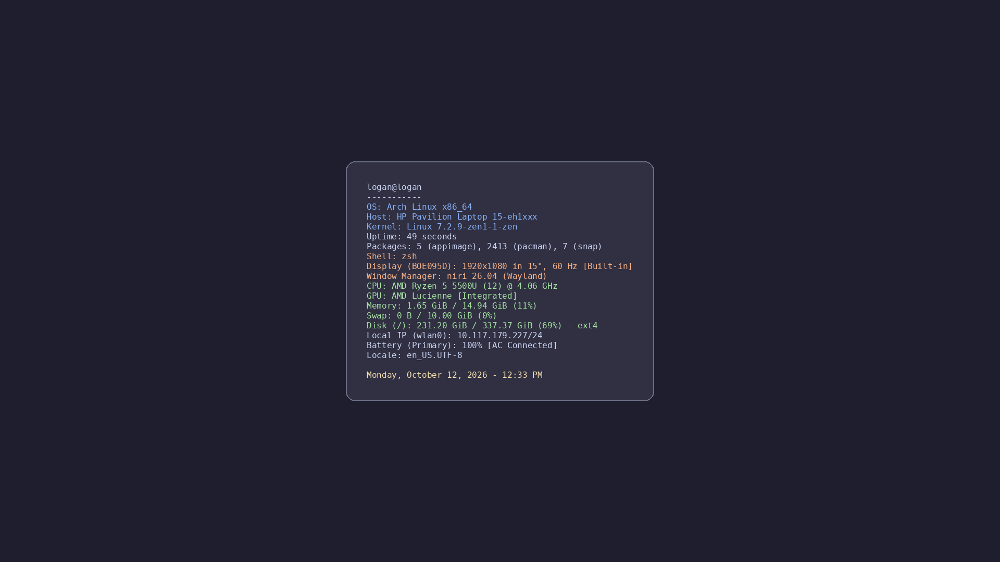

# wallpaper

A live system-info wallpaper: every 15 seconds it checks your system info and, if anything changed, renders it onto a
Catppuccin-style background and sets it as the wallpaper. Two versions, one per desktop:

| | Folder | Info from | Sets it with |
|---|---|---|---|
| **niri** (and other layer-shell Wayland compositors) | [`niri/`](niri/) | `fastfetch` | `awww`, with a fade |
| **KDE Plasma** | [`kde/`](kde/) | `neofetch` | `plasma-apply-wallpaperimage` |

<p align="center"></p>

<p align="center"><sub>A real frame from an HP Pavilion running niri 26.04, 49 seconds after boot.</sub></p>

> [!TIP]
> Whatever your fetch tool prints ends up on the screen. If your neofetch or fastfetch config shows a public IP or a
> weather location, take those modules out before you screenshot your desktop.

---

## niri

### Requirements

| Package (Arch) | Why |
|---|---|
| `niri` | screen size is read with `niri msg --json outputs` (falls back to 1366x768 if that fails) |
| `awww` | sets the wallpaper (`awww-daemon` must be running; `awww` was formerly called `swww`) |
| `fastfetch` | the system info |
| `python-pillow` | draws the image |
| `ttf-dejavu` | default font (falls back to JetBrains Mono, Fira Code, Liberation Mono, Noto Sans Mono, then Pillow's built-in font) |

```bash
sudo pacman -S awww fastfetch python-pillow ttf-dejavu
```

### Install

```bash
# 1. the script
install -Dm755 niri/sysinfo-wallpaper ~/.local/bin/sysinfo-wallpaper

# 2. start awww-daemon with niri: add this line to ~/.config/niri/config.kdl
#    spawn-at-startup "awww-daemon"

# 3. run it as a systemd user service
install -Dm644 niri/sysinfo-wallpaper.service ~/.config/systemd/user/
systemctl --user daemon-reload
systemctl --user enable --now sysinfo-wallpaper.service
```

The service is tied to `graphical-session.target`, so it starts and stops with your niri session. If it starts before
`awww-daemon` is ready, the script waits up to 30 seconds for it.

```bash
sysinfo-wallpaper --once                     # render and apply one frame, then exit
systemctl --user restart sysinfo-wallpaper   # after editing the script
journalctl --user -u sysinfo-wallpaper       # logs
```

<details>
<summary><b>How it works and what to change</b></summary>

<br>

- Runs `fastfetch --pipe --logo none` with a fixed module list, so the output is plain text with no ANSI codes.
- Renders it centered on a `#1e1e2e` background at the screen's logical size, with line colors by category (system in
  blue, hardware in green, desktop in orange, date in yellow).
- Only re-renders when the text changed. Uptime, memory, battery and IP all change, so in practice it redraws about
  once a minute.
- Writes the PNG to `~/.cache/sysinfo-wallpaper/wallpaper.png` (or `$XDG_CACHE_HOME`) through a temp file and rename,
  so `awww` never reads a half-written image, and applies it with a 0.7 second fade.

Constants near the top of `sysinfo-wallpaper`:

| Setting | What it does |
|---|---|
| `INTERVAL` | seconds between checks (default 15) |
| `MODULES` | fastfetch modules shown, colon-separated (run `fastfetch --list-modules` for names) |
| `FONT_PATHS` | fonts tried in order |

Colors are in `create_wallpaper()`. The `Terminal` module is left out on purpose, because under systemd it always
reports "systemd". The `Shell` line uses `$SHELL` for the same reason: fastfetch reports its parent process.

Only tested on niri with a single screen. On several screens the image is sized to the first output niri reports, and
`awww img` applies it to every output. On another compositor, `get_screen_size()` is the only niri-specific part:
replace it (e.g. with `wlr-randr`) or rely on the 1366x768 fallback.

</details>

---

## KDE Plasma

The original version. Needs `neofetch` and `python-pillow`.

```bash
install -Dm755 kde/neofetch-wallpaper ~/.local/bin/neofetch-wallpaper
install -Dm644 kde/neofetch-wallpaper.service ~/.config/systemd/user/
systemctl --user daemon-reload
systemctl --user enable --now neofetch-wallpaper.service
```

Frames go to `~/.cache/neofetch-wallpaper/` (or `$XDG_CACHE_HOME`). Each frame gets a new file name, because Plasma
doesn't reload an image whose path hasn't changed, and the script removes its own older frames; nothing else in that
folder is touched. The image is 1920x1080; change `width, height` in `main()` for another screen.

`kde/neofetch_wallpaper_simple.py` renders one frame to the current folder and doesn't set it, which is handy for a
quick look:

```bash
python kde/neofetch_wallpaper_simple.py
```
